# opxOSS

A free and open-source mobile pentest suite for Android. **Authorized testing only.**

opxOSS puts network, wireless, BLE and web security tools in one app. On a rooted phone it runs them natively inside a Debian trixie arm64 chroot. Without root it boots the same Debian userland in a QEMU VM or a User Mode Linux engine and routes the tools into the guest. A built-in terminal drops straight into that environment — no extra shell app required.

[Download latest APK](https://github.com/OPX-Aminul/opx-oss/releases/latest) · [Channel](https://t.me/opx-oss) · [Chat](https://t.me/opxosschat) · [Issues](https://github.com/OPX-Aminul/opx-oss/issues)

| | |
|---|---|
| **Package** | `com.opx.oss` |
| **ABI** | `arm64-v8a` only |
| **Min Android** | 7.0 (API 24) |
| **License** | [GNU GPL v3.0](https://www.gnu.org/licenses/gpl-3.0.html) |

<p align="center">
  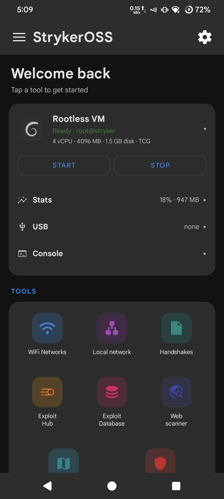
  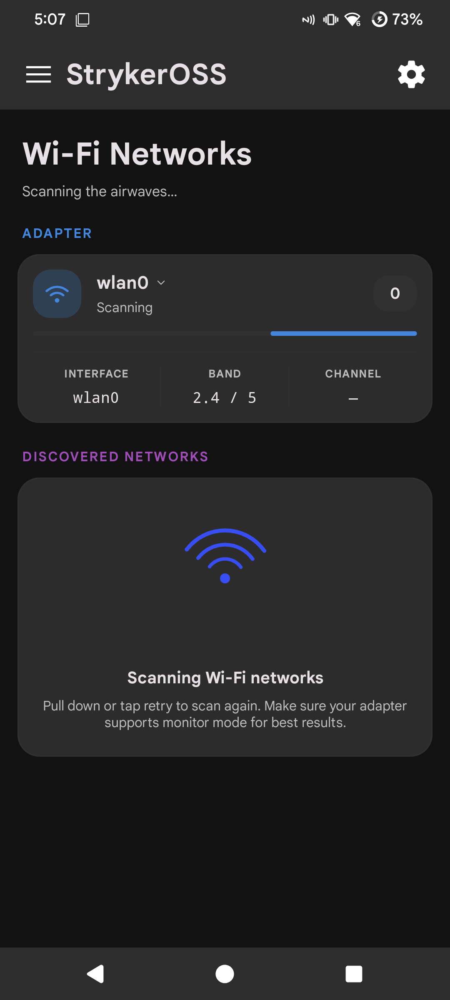
  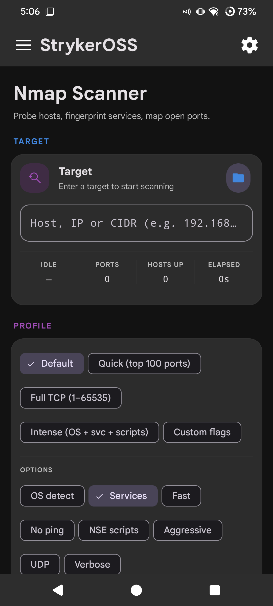
</p>

---

## Download

1. Open the [latest release](https://github.com/OPX-Aminul/opx-oss/releases/latest).
2. Download `opxOSS-*.apk`.
3. Sideload it (`adb install opxOSS-*.apk`, or open the APK on the device).
4. On first launch the installer will:
   - Ask for a **license key** (`XXXX-XXXX-XXXX`) — internet required to activate.
   - Request root when available (`su`), or set up a **rootless engine**.
   - Request runtime permissions (storage, location, notifications, Bluetooth, audio).
   - Download and unpack the Debian trixie arm64 core.
   - Optionally install Metasploit, Nuclei, Hydra and SearchSploit.

In-app updates are offered automatically from this repository's releases. Check **Dashboard** or **Settings** after install.

---

## How it runs

opxOSS picks an engine on first launch. You can change it later from Core manager.

| Engine | Needs root | What it is |
|---|---|---|
| **Chroot** | Yes | Native Debian trixie arm64 at `/data/local/opxoss/release`. Fastest path. Magisk or KernelSU recommended. |
| **QEMU** | No | Boots the same Debian rootfs in an arm64 VM. Tools run in the guest over SSH. |
| **UML** | No | User Mode Linux — Linux as a normal process, no CPU emulation. The app probes the device and can pick this itself. |

**Root-only modules:** HID Attacks, USB Arsenal, MAC changer.

**Always available:** Dashboard, WhisperPair, GeoMac, Wordlists, Logs, About.

Open the terminal from the drawer, or from the **opxOSS Terminal** launcher icon.

---

## Modules

| Module | What you can do |
|---|---|
| **Dashboard** | Live overview of the engine, USB adapters, mount state and quick actions. News and in-app updates land here. |
| **WiFi networks** | Scan, deauth, handshake capture, WPS (Pixie Dust, common pins, custom pins) via an **external** monitor-mode USB adapter. Phone Wi-Fi is not used. |
| **Handshakes** | Store, rename and share captures. Export to OnlineHashCrack or crack on-device. |
| **MAC changer** | Spoof or restore the hardware address of a wireless interface. Root only. |
| **WhisperPair (BLE)** | Fast Pair discovery, CVE-2025-36911 check and exploit chain, post-pair account-key write, HFP audio capture. |
| **Local network** | Host discovery, port scans, OS fingerprinting, per-device exploit dispatch with a live terminal. Root-free mDNS / SSDP / NetBIOS / SNMP discovery is included. |
| **Nmap** | Profiles (Default, Quick, Full TCP, Intense) plus flag chips: `-O`, `-sV`, `-F`, `-Pn`, `-sC`, `-A`, `-sU`. Recent-target history and export. |
| **Web scanner (Nuclei)** | Multi-target scans, severity-grouped findings, per-finding evidence. |
| **Arsenal** | Custom exploit / scanner database. Templates accept `{IP}`, `{PORT}`, `{MAC}`, `{GW}`, `{MASK}`. |
| **HID Attacks** | DuckyScript USB HID injection (Hak5 v1 + v3). Layouts: US, GB, DE, FR, ES, IT, RU. Bundled sample payloads. Root + gadget kernel. |
| **USB Arsenal** | USB-gadget profiles: HID keyboard/mouse, mass-storage, RNDIS/ECM/ACM. Custom VID/PID/serial; mount `.img` / `.iso`. Root + gadget kernel. |
| **Metasploit** | MSF console in the Debian environment — sessions, payload generation, module browser. |
| **GeoMac** | OSM map of captured BSSIDs / handshakes. WiGLE-style KML/CSV export. |
| **VNC desktop** | In-guest XFCE VNC (default port 5901). Start / stop / password / resolution from the app. |
| **Wordlists** | Manage, preview, generate and normalize lists. Bundled SecLists (top passwords, WPA, usernames, web paths, default router creds). |
| **Hash cracker** | MD5, SHA-1/224/256/384/512, NTLM, MySQL 4.1+, MD5(MD5). |
| **Cameradar** | RTSP camera discovery. |
| **Core manager** | Mount / unmount / repair the chroot or VM, switch engines, manage installed components. USB chain view shows where an adapter stops. |
| **Logs / diagnostics** | Live logs and exportable diagnostics. |

<p align="center">
  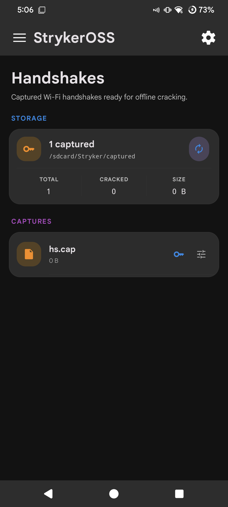
  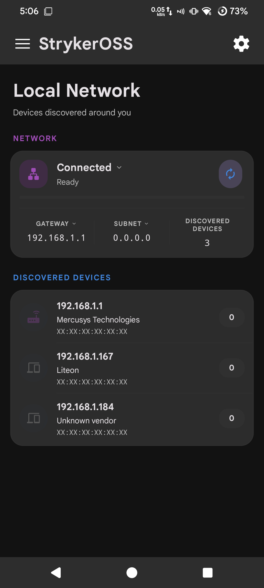
  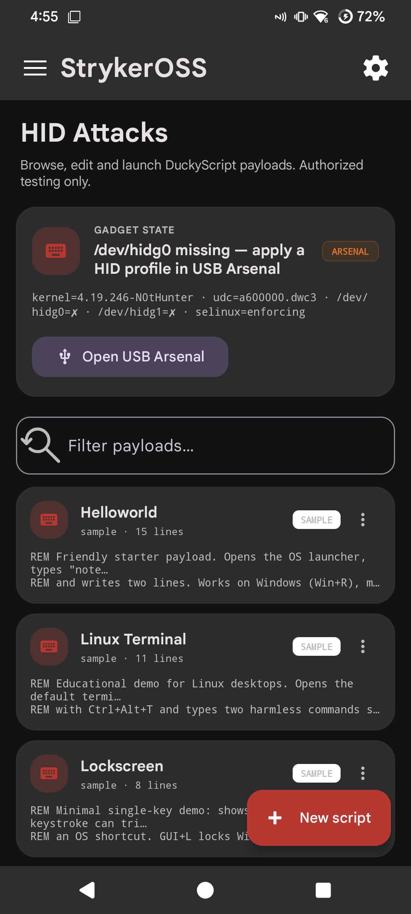
  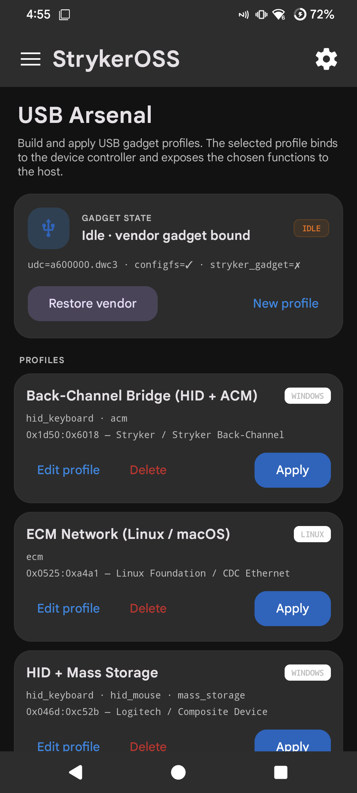
</p>

<p align="center">
  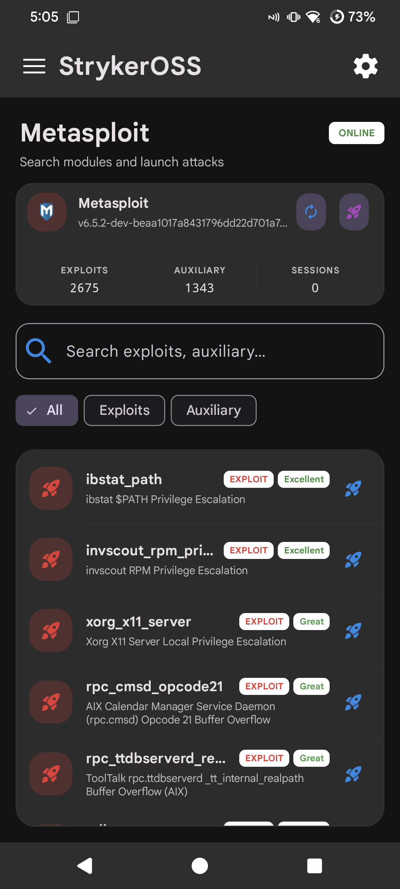
  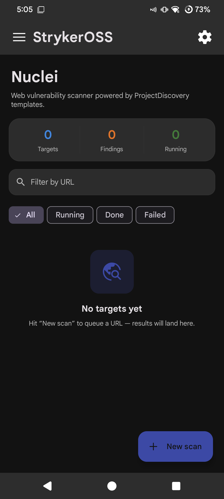
  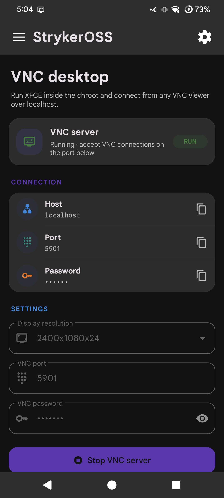
  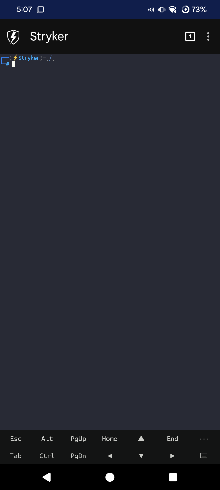
</p>

---

## Requirements

- **arm64-v8a** Android device (32-bit is not supported).
- **~1 GB free** internal storage for the Debian core, tools and signatures.
- **Root (optional but recommended)** — Magisk or KernelSU. Without root, use the QEMU or UML engine.
- **External USB Wi-Fi adapter** for monitor-mode / injection. Phone Wi-Fi is not used.

### Recommended adapters

| Chipset | Notes |
|---|---|
| Atheros AR9271 (`ath9k_htc`) | Strong monitor + injection. **TL-WN722N v1** is this chipset; **v2/v3 is RTL8188EUS — not the same.** |
| MediaTek MT7612U | Recommended for pentesting; VIF-capable. |
| Ralink RT28xx (`rt2800usb`), AR7010 | Solid. |
| rtw88 RTL8821CU / 8822BU / 8822CU | Kernel 6.2+. |
| RTL8812AU | Mainline 6.14. |

Avoid cheap MT7601U clones (often dead EEPROM). Older Realtek rtl8xxxu (RTL8188CUS / 8192CU / 8188EUS) has only partial injection.

### HID / USB Arsenal kernel

Optional. Needed only for gadget features:

- `CONFIG_USB_CONFIGFS=y`
- `CONFIG_USB_CONFIGFS_F_HID=y`
- `CONFIG_USB_CONFIGFS_MASS_STORAGE=y` (mass-storage profiles)
- `CONFIG_USB_CONFIGFS_RNDIS=y` / `CONFIG_USB_CONFIGFS_ECM=y` (network profiles)
- Kernel ≥ 3.19 and `/sys/class/udc/` populated

NetHunter, KernelSU-Next and most modern OEM kernels already meet this.

---

## Releases and updates

Every app release on this repo ships:

- `opxOSS-<version>.apk` — the signed application
- `opxoss_manifest.json` — what the in-app updater reads (version, APK URL, sha256)

Larger payloads (Debian chroot, QEMU kernel/rootfs, UML kernel) are published as separate release tags (`chroot`, `qemu`, `uml`) and downloaded by the installer on first run — they are not inside the APK.

Verify an APK against the `sha256` in `opxoss_manifest.json` before installing if you want to be sure.

---

## HID sample payloads

Bundled under HID Attacks (DuckyScript):

| Payload | What it does |
|---|---|
| `helloworld` | Opens Notepad and types “Hello, world!” |
| `lockscreen` | Win+L |
| `linux_terminal` | Ctrl+Alt+T demo |
| `macos_spotlight` | Spotlight → Terminal |
| `win_typing_lesson` | Notepad typing demo |
| `win_capture_hostname` | Hostname over CDC ACM |
| `start_display_feed` | Host screen JPEG feed over ACM |

Save, rename or hide payloads in the app. Keymaps: US / GB / DE / FR / ES / IT / RU.

---

## License

opxOSS is free software under the **GNU General Public License v3.0**.

```
opxOSS — a mobile pentest suite for Android.
Copyright (C) 2026 OP AMINUL FF (opx-team)

This program is free software: you can redistribute it and/or modify it under
the terms of the GNU General Public License as published by the Free Software
Foundation, either version 3 of the License, or (at your option) any later
version.
```

Bundled third-party components (terminal emulator, SDL/Xorg, custom-tabs, wordlists, PoCs, fonts) keep their own GPLv3-compatible licenses. See in-app **About → Open-source licenses**.

---

## Disclaimer

opxOSS is for **authorized security testing, education and research only**. You are responsible for complying with all applicable laws and for obtaining explicit permission before testing any system or device you do not own. The authors accept no liability for misuse.

---

## Community

- Channel: [t.me/opx-oss](https://t.me/opx-oss)
- Chat: [t.me/opxosschat](https://t.me/opxosschat)
- Issues: [github.com/OPX-Aminul/opx-oss/issues](https://github.com/OPX-Aminul/opx-oss/issues)
- Developer: [github.com/OPX-Aminul](https://github.com/OPX-Aminul)
